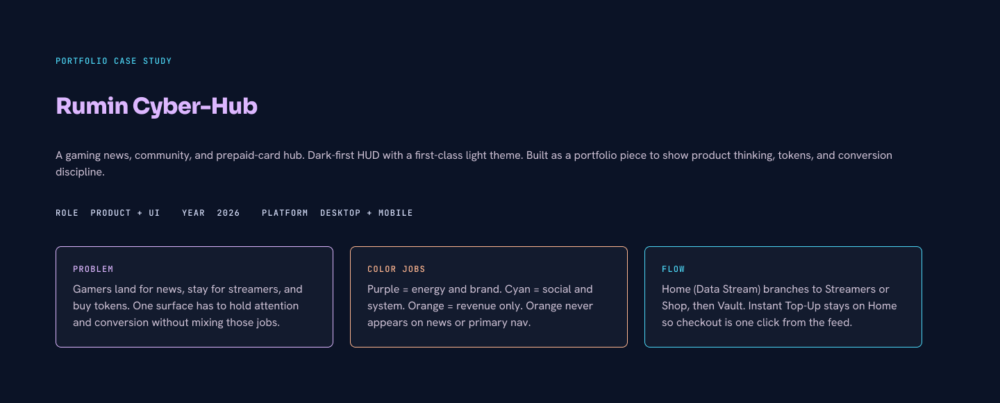
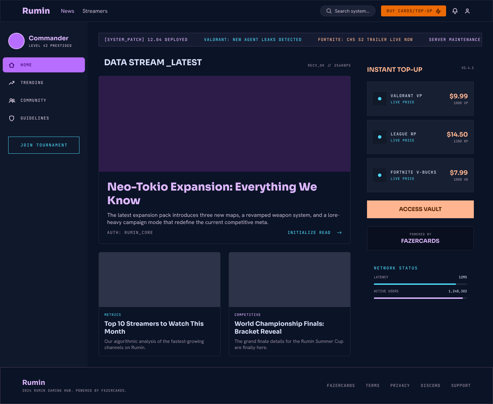
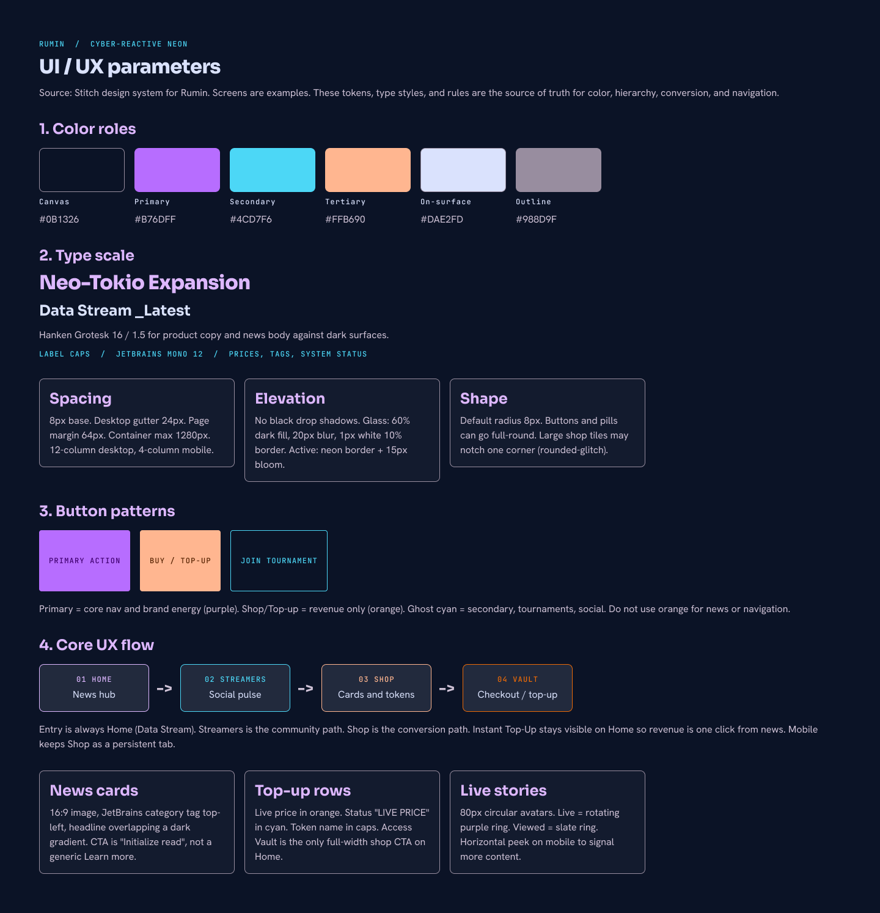
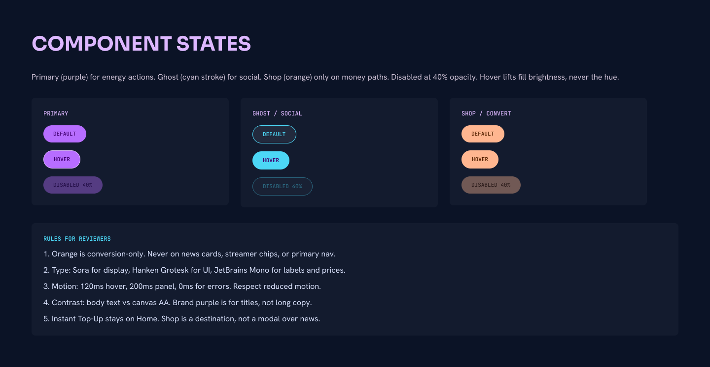
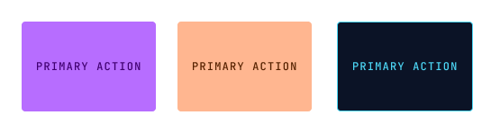
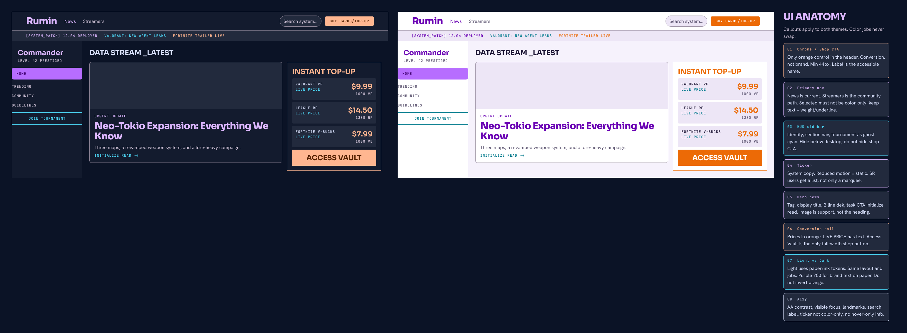
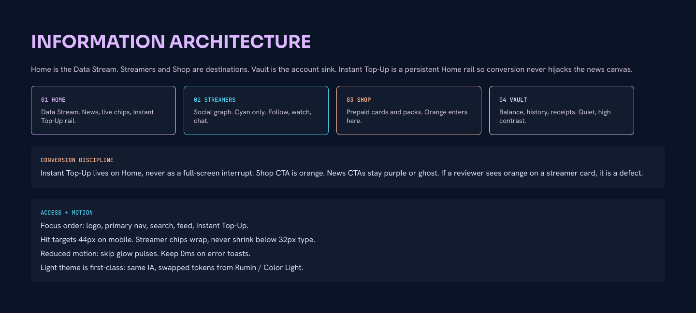
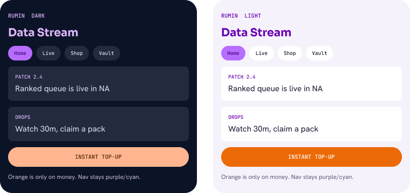

# Cyber-Hub UI case study

Portfolio exploration for Gorumin (Rumin): a gaming news, community, and prepaid-card hub. These screens are **design artifacts**, not an engineering spec. They are not the current storefront implementation.

**Figma file:** [Rumin Cyber-Hub](https://www.figma.com/design/LrxpE6NSE4tzdLU8L4rIMk/)

## How this was made

The boards were authored **in Figma**, driven from **Cursor**, not by painting pixels by hand.

1. **Google Stitch** generated the first Cyber-Hub HTML (project "Rumin: Gamers Loot Feed", system **Cyber-Reactive Neon**).
2. Cursor transcribed that HTML into Figma using the **Figma Plugin API** (auto layout, variables, text styles, component sets).
3. When the official Figma MCP hit the Starter monthly cap, work continued through a **local Figma MCP Bridge** (desktop plugin + WebSocket). Cursor kept writing frames, tokens, and copy into the open file.

This page is the public record of that workflow.

## Patterns used

| Pattern | How it shows up |
| --- | --- |
| **Semantic color jobs** | Purple = brand energy. Cyan = social / system. Orange = conversion only. Orange never lands on news cards, streamer chips, or primary nav. |
| **Tokenized themes** | Primitives (`Rumin / Primitives`) alias into `Rumin / Color` (Dark) and `Rumin / Color Light` (Light). Figma Starter allows one mode per collection, so light is a sibling collection, not a second mode. |
| **Type roles** | Sora for display, Hanken Grotesk for UI, JetBrains Mono for labels and prices. |
| **Variant buttons** | Component set `Kind = Primary \| Shop \| Ghost`, plus Default / Hover / Disabled (40% opacity). |
| **Auto layout HUD** | Nested auto-layout frames, 8px spacing scale, `radius/md`. |
| **Persistent conversion rail** | Instant Top-Up stays on Home. Shop is a destination, not a modal over the feed. |
| **Information architecture** | Home (Data Stream) branches to Streamers or Shop, then Vault. |
| **First-class light theme** | Same IA and components, swapped tokens. Dark is default. |
| **Annotation over handoff** | Numbered callouts and reviewer rules instead of Jira stories. This file is for a portfolio, not a sprint. |
| **Motion + a11y notes** | 120ms hover, 200ms panel, 0ms errors, reduced-motion, 44px mobile targets, AA body on canvas. |

Related Stitch prompt (storefront + admin, Spanish UI): [`stitch-prompt.md`](./stitch-prompt.md).

## Screens

### Cover

Role, problem, color jobs, and flow on one board.

### Desktop Cyber-Hub (dark)

Stitch-derived home: Data Stream, live chips, Instant Top-Up rail.

### Foundations (Cyber-Reactive Neon)

Canvas, type, spacing, and token map.

### Component states

Primary, Ghost/social, and Shop/convert with reviewer rules.

### Annotated dark + light pair

Same hub, two themes, numbered legend.

### Information architecture

Home, Streamers, Shop, Vault, plus conversion and access notes.

### Mobile dark + light

Compressed Data Stream. Orange is only on Instant Top-Up.

## What this is not

- Not the live [gorumin.com](https://gorumin.com) checkout.
- Not a Medusa / Next.js implementation ticket.
- Not GPI / SBD work. Rumin is a personal product.

The commerce POC (Fazer Cards + Mercado Pago) lives in the rest of this repo. This folder is the visual thesis for a community-first hub around that shop.
